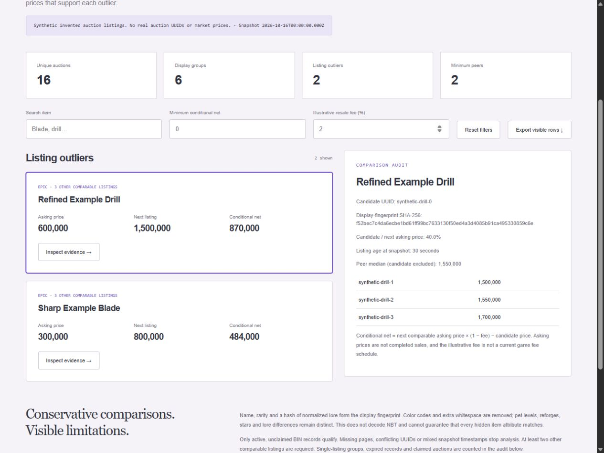

# SkyblockSniper · Snapshot Review

A read-only auction-analysis fork of [csjh/SkyblockSniper](https://github.com/csjh/SkyblockSniper), with the original GPL-3.0 license retained. This fork replaces the import-time polling loop with complete-snapshot validation, deterministic comparison and an evidence viewer. It does not purchase items, issue game commands, copy to the clipboard or send notifications.



## Run the offline demo

Python 3.10+; the fixture and analysis use only the standard library:

```bash
python SkyblockSniper.py
python -m http.server 49217
```

Open http://localhost:49217/review/. Search the two generated outliers, change the illustrative resale fee or minimum conditional net, inspect peer listings and export the visible results. All 16 fixture auctions, names, UUIDs and prices are explicitly **synthetic**. No current market result or actual resale is claimed.

```bash
python -m unittest discover -s tests
python SkyblockSniper.py --maximum-ratio 0.5 --minimum-price 250000
```

## What changed

- Every API page must belong to the same `lastUpdated` snapshot and all expected page numbers must be present. Identical UUIDs deduplicate; conflicting duplicates stop analysis.
- Scoring occurs only after all records are collected. Results are independent of page and auction order, eliminating the original shared mutable price-map race.
- Name, tier and normalized-lore hash form a conservative display fingerprint. Color codes and whitespace are normalized; pet levels, reforges, stars and lore differences are preserved. The earlier broad string replacement could merge materially different items.
- Active, unclaimed BIN records with valid prices/times qualify. At least two **other** listings are required, and the candidate is excluded from the peer median. Expired records and unsupported groups have explicit audit counts.
- Imports are inert, HTTP requests have timeouts and page bounds, and snapshot rollover fails clearly. No COFL name-based price lookup, infinite polling, beep or clipboard side effect occurs.

## Analyze your own snapshot

The input format is `{ "provenance": "describe the source", "pages": [...] }`, where pages retain the Hypixel API page structure. Saved inputs are evaluated at their snapshot timestamp for reproducibility. The output records that timestamp and the configured thresholds. It is not evidence that a saved auction is still available.

```bash
python SkyblockSniper.py --input snapshot.json --output review/report.json
```

For an intentional, bounded public API read, install `requirements.txt` and opt in:

```bash
python -m pip install -r requirements.txt
python SkyblockSniper.py --live-read-only --max-pages 100 --output review/local-live.json
```

The fetcher uses the official [Hypixel v2 public API](https://api.hypixel.net/), once per page, and aborts mixed snapshots. Review API policies before using live reads. No live fetch was needed for the verified demo. The default age limit is 120 seconds for live snapshots; listings must be at most 300 seconds old at evaluation. Replacing `review/report.json` explicitly lets the viewer inspect a chosen report.

## Interpretation and tests

Conditional net is `next comparable asking price × (1 − illustrative fee) − candidate asking price`. Asking prices are not completed sales, can be manipulated and do not guarantee liquidity or profit. The fee is a user-supplied scenario assumption, not the current game schedule. This display fingerprint does not decode NBT and cannot prove equivalence of hidden attributes. No recommendation to buy is implied.

Eleven tests cover known fixture results, ordering invariance, deduplication/conflicts, missing/mixed pages, pet/upgrade identity, stale/future timestamps, exclusions, invalid inputs, bounded HTTP/rollover and network-free import. The browser verification covers search, fee changes, empty-filter state and mobile layout. Original project history remains in Git; fork improvements are attributed here without claiming upstream authorship.
